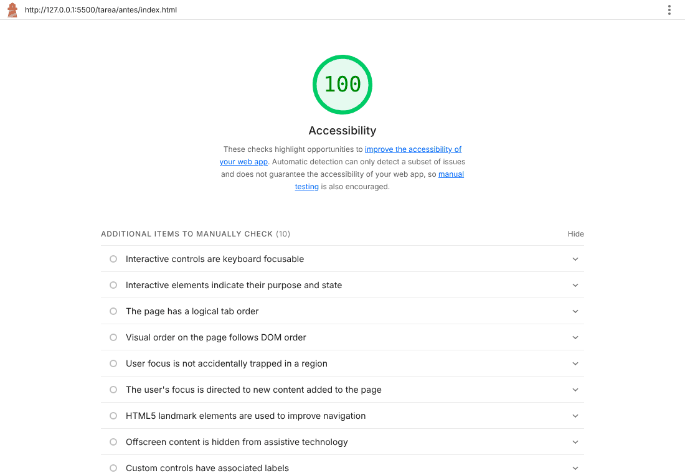
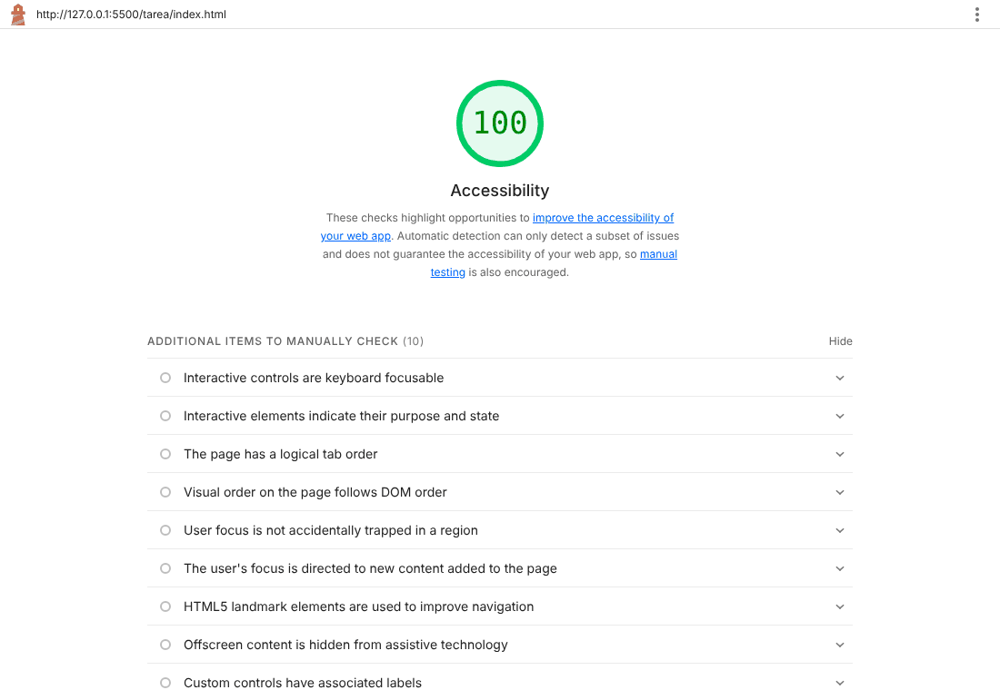
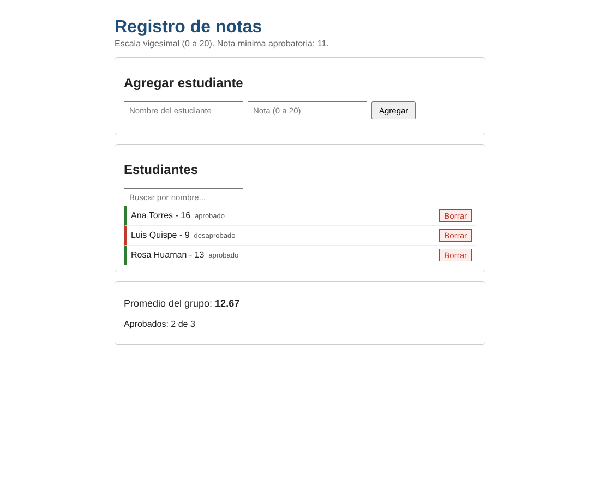
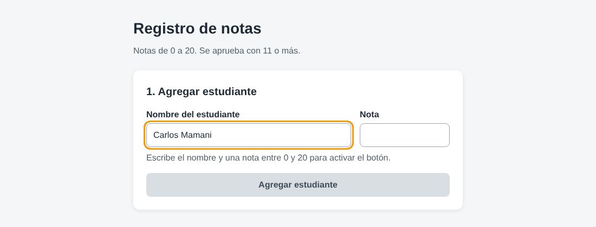
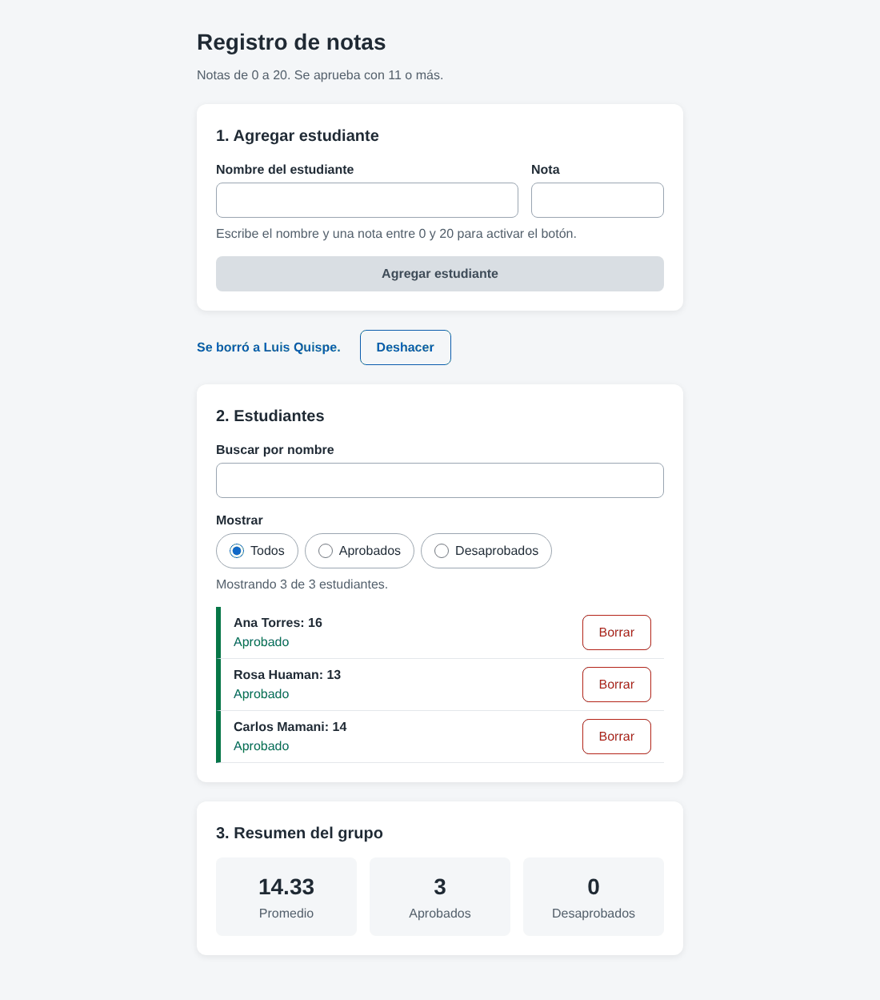

# Auditoría UX: Registro de notas

**Pantalla auditada:** el *Registro de notas* que construí en la tarea del Laboratorio 08 (DOM, eventos y objetos). Elegí esta pantalla porque es mi aplicación de notas: agrega, busca y borra estudiantes con su nota.

- Versión original (antes): [tarea/antes/](../tarea/antes/)
- Versión rediseñada (después): [tarea/](../tarea/)
- Página publicada: https://danielmamanic-ui.github.io/taller-ux/tarea/

## 1. Heurísticas de Nielsen

| Heurística | Problema en la pantalla original | Solución aplicada |
|---|---|---|
| **Visibilidad del estado** | Al borrar, el mensaje «Se elimino a…» salía arriba, lejos de la lista, y no se veía si estabas abajo. Tampoco se sabía cuántos estudiantes mostraba la búsqueda. | Un aviso fijo entre el formulario y la lista, con `role="status"`, después de cada acción («Estudiante agregado», «Se borró a…», «Se recuperó a…»). Además, un contador: «Mostrando 2 de 3 estudiantes». |
| **Coincidencia con el mundo real** | Términos técnicos o sin tilde: «Escala vigesimal», «Nota minima aprobatoria», «numero», «Se elimino». El estado salía en minúscula y en gris. | Lenguaje de un docente: «Notas de 0 a 20. Se aprueba con 11 o más.» Se corrigieron las tildes y el estado se escribe «Aprobado» o «Desaprobado», en verde o rojo. |
| **Control y libertad** | «Borrar» eliminaba al estudiante al instante, sin confirmar y sin forma de recuperarlo. | Al borrar aparece **Deshacer** durante 8 segundos y el estudiante vuelve a su mismo lugar. El foco pasa al botón Deshacer para usarlo también con el teclado. |
| **Prevención de errores** | Se podía pulsar «Agregar» con los campos vacíos o con nota 25; el error recién se avisaba después. | El botón **Agregar estudiante** está desactivado hasta que haya un nombre y una nota entre 0 y 20. Una pista explica qué falta. El campo nota tiene `min="0"`, `max="20"` y `required`. **No se puede agregar una nota vacía.** |
| **Reconocer, no recordar** | Los campos usaban solo `placeholder`: al escribir, el texto desaparecía y había que recordar si el campo era «Nota (0 a 20)». | Cada campo tiene un `<label>` visible que no desaparece. El rango 0–20 se muestra siempre en la pista. |

## 2. Leyes de usabilidad

| Ley | Cambio | Justificación |
|---|---|---|
| **Fitts** | El botón **Agregar estudiante** ocupa todo el ancho, mide 44 px de alto y está justo debajo de los campos. Los botones **Borrar** pasaron de unos 22 px a 44 px y quedaron a la derecha, separados del nombre. | Un objetivo grande y cercano se alcanza más rápido. La separación evita borrar a alguien por error. |
| **Hick** | Un filtro con solo tres opciones (Todos, Aprobados, Desaprobados), además de la búsqueda. | Con menos elementos a la vista, la persona decide más rápido a quién revisar. Se dejaron solo tres opciones para no agregar más decisiones. |
| **Miller** | La pantalla se dividió en tres bloques numerados (1. Agregar, 2. Estudiantes, 3. Resumen). El resumen muestra tres datos en tarjetas: promedio, aprobados y desaprobados. | Recordamos pocos elementos a la vez. Agrupar la información en bloques pequeños reduce la carga de memoria. |

## 3. Principios visuales y accesibilidad

- **Colores con variables CSS** en `:root` (`--color-primario`, `--color-error`, `--color-exito`, etc.). El azul es para la acción, el rojo para borrar y desaprobados, y el verde para el éxito y los aprobados.
- **Un solo `h1`** («Registro de notas»). Cada bloque tiene un `h2`.
- **Espaciado consistente** con variables de 8, 16, 24 y 32 px.
- **`label` en cada campo**, incluidos la búsqueda y los botones de filtro. La pantalla no tiene imágenes; si se agrega alguna, debe llevar `alt`.
- **Foco visible:** `:focus-visible` dibuja un borde naranja de 3 px.
- **Contraste:** el texto principal es #1f2933 sobre blanco (más de 14:1) y el texto secundario es #52606d (más de 6:1). Ambos superan el mínimo de 4.5:1.
- **Botones de al menos 44 px de alto.** Cada «Borrar» tiene `aria-label="Borrar a <nombre>"` para que el lector de pantalla diga a quién borra.

## 4. Lighthouse: antes y después

| Antes | Después |
|---|---|
|  |  |

Las dos versiones obtuvieron **100** en Accesibilidad. Esto me enseñó algo importante: Lighthouse acepta el `placeholder` como nombre del campo y no revisa si se puede deshacer un borrado, si el botón deja enviar datos vacíos o si los mensajes se ven. Esos problemas solo aparecieron en la auditoría con las heurísticas y en la prueba con el teclado. **El 100 no significaba que la pantalla original fuera fácil de usar.**

## 5. Capturas

**Antes:**

**Después:** el botón se mantiene desactivado mientras falten datos.

**Después:** el aviso aparece al borrar, con la opción Deshacer.

